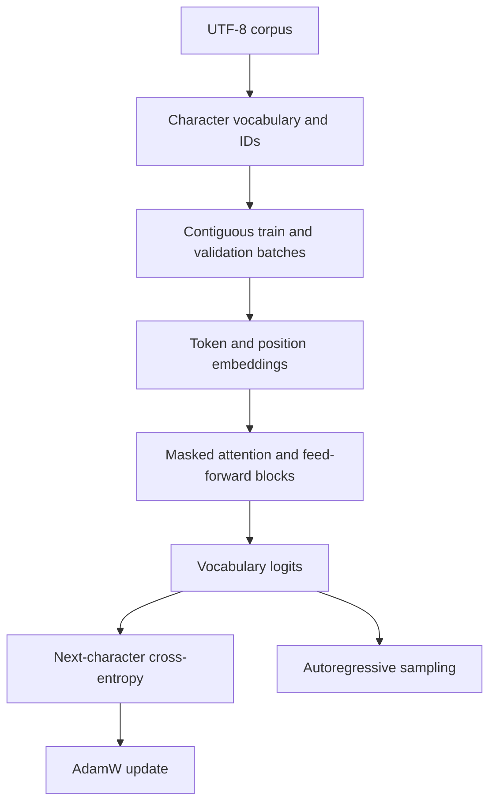

# Character-language-model architecture

Maintenance review: **11 November 2026**. Inspected base commit: `7256adc4834916d816f66be2823e7a658fffc026`.

Educational PyTorch notebooks implementing a bigram model and a small GPT-style decoder. This is character-level learning work, not a pretrained production LLM.

## Current implementation

| Source boundary | Responsibility and implementation status |
| --- | --- |
| `bigram.ipynb` | Embedding lookup baseline; no attention or contextual reasoning. |
| `gpt-v1 (3).ipynb` | Character embeddings, positions, causal attention heads, blocks and vocabulary head. |
| `data/sample.txt` | Original synthetic smoke corpus; not the missing original training book. |
| `scripts/notebook_smoke.py` | Extracts actual notebook definitions into a tiny CPU configuration and checks model contracts. |

## Changes in this maintenance pass

The notebooks no longer silently depend on an absent `wizard_of_oz.txt`. They load `LLM_CORPUS` or the committed original synthetic fixture, validate corpus length before splitting, reject unknown batch splits, and set the training seed. Changed-cell outputs are cleared to avoid presenting stale notebook output as a fresh run.

## Verification and repeatable checks

Install PyTorch CPU, then run `python scripts/notebook_smoke.py`. It checks both actual notebook classes for finite loss, backward gradients, generation shape, future-token masking and valid batch shape using small synthetic tensors. This is not full notebook execution or a training-quality comparison.

Record the exact commit and hosted workflow result when reviewing a change. Passing a focused regression does not establish end-to-end reliability or measured capacity.

## Scale and ownership decisions

These are explicit **future design steps**, not implemented infrastructure or measured capacity claims.

| Pressure or boundary | Decision and next evidence |
| --- | --- |
| Training data | Separate corpus ingestion, immutable train/validation splits and tokenizer manifests before larger experiments; use streaming or memory-mapped batches when measured RAM requires it. |
| Compute | Parameterize batch/context/embedding sizes and log peak memory and validation loss; introduce mixed precision or distributed training only after a reproducible single-device baseline. |
| Generation | Use evaluation mode and no-grad for measured inference; checkpoint model state plus vocabulary and configuration together. Avoid loading untrusted pickle files. |

Keep one owner for each data contract, centralize paths/configuration, and review dependency changes with the smallest relevant regression suite. Separate computed results from static fixtures; version inputs with artifacts. Before release, reproduce setup from a clean checkout and check both failure paths and resource cleanup.

## Operational limits and recovery

Training loops remain notebook stateful and full-corpus in-memory. The default fixture is far too narrow to establish language quality. No serving API, tokenizer checkpoint manifest, resumable optimizer state or distributed training is implemented.

Keep a known-good commit and backup mutable experiment artifacts before running migrations or training. On failure, preserve the error and input/configuration version; restore the prior artifact set or checkout the known-good code before retrying. No cloud deployment, paid service provisioning, data migration or production-scale load test was performed by this maintenance pass.
